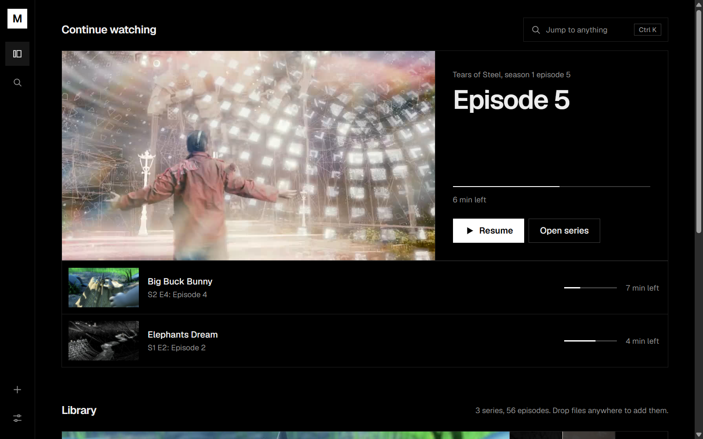
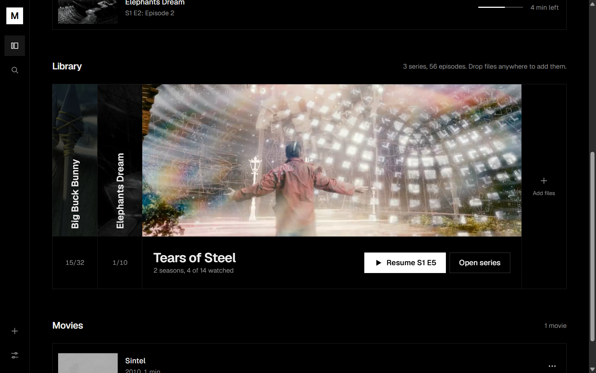
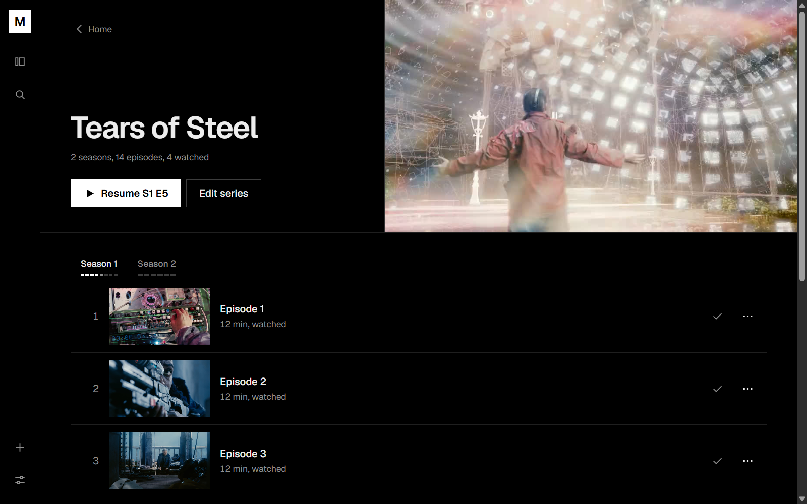
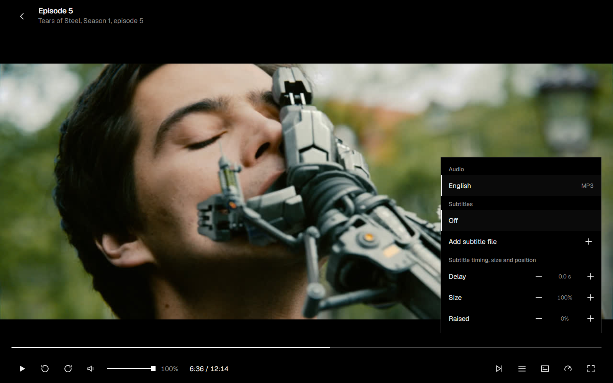

# Marquee

**A library and player for the video files already on your disk.** Drop a folder in. Marquee sorts it into series, seasons and episodes from the file names, remembers where you stopped in every episode, and plays the next one when you finish.

No account, no server, no internet. Windows 11, free, open source.



## The problem

A folder of video files is not a library. A plain player opens one file at a time, so you end up keeping the library in your head:

- Which episode was I on, and how far in?
- Which of these forty files comes next?
- Why did the subtitles switch back to the wrong language again?

Media servers solve this, but they want a server running, an account, and files renamed to their rules. Marquee is for one person and one computer: point it at the files as they are and press Play.

## What it does

| | |
|---|---|
| **Sorts by file name** | Reads `Show.S02E01.1080p.mkv`, `Show (2011) - S01E01 - Pilot.mkv`, `1x02`, `Season 2\Episode 12.mkv`, anime `Name - 12`, and numbered course folders. Seasons in different folders merge into one series. You review the result before it is saved. |
| **Lets you fix anything** | Rename a series, season or episode in place, move an episode, add a season, mark watched. What you change by hand is never overwritten. |
| **Resumes** | Progress is saved every five seconds. Play picks the episode you were on, three seconds before where you stopped. |
| **Plays the next episode** | A short countdown at the end, across seasons. |
| **Plays everything** | Built on [mpv](https://mpv.io): MKV, MP4, AVI, WebM; H.264, HEVC, AV1, VP9; 4K and HDR with tone mapping; GPU decoding. |
| **Gets subtitles right** | SRT, styled ASS with the fonts inside the file, PGS and VobSub. Subtitle files beside the video load by themselves, or drop one on the player. Delay, size and position controls. |
| **Remembers languages** | Pick an audio or subtitle language once and it holds for the rest of that series. |
| **Watches a folder** | Name the folder your new files land in and they are sorted in automatically. |
| **Survives moved files** | Moved a folder to another drive? Marquee finds the files again and keeps names and progress. |
| **Previews the scrubber** | Hover the progress bar to see a frame from that moment. |
| **Leaves your files alone** | It never moves, renames, copies or deletes a video file. Removing something from the library only forgets it. |







## Install

1. Download `Marquee_x.y.z_x64-setup.exe` from the [latest release](https://github.com/mandarwaigaonkr/marquee/releases/latest).
2. Run it. The installer is not code-signed yet, so Windows SmartScreen shows "Windows protected your PC". Choose **More info**, then **Run anyway**. Signing is being arranged; see [docs/CODE_SIGNING.md](docs/CODE_SIGNING.md).
3. Open Marquee and drop a folder of videos on the window, or choose **Add files**.

Made for and tested on Windows 11, 64-bit. Your library is stored in `%APPDATA%\com.mandar.marquee`.

## Keys

| Key | Does |
|---|---|
| Space or K | Play or pause |
| Left, Right | Back or forward 10 seconds |
| Up, Down, mouse wheel | Volume |
| M | Mute |
| F | Fullscreen |
| N | Next episode |
| S | Audio and subtitles |
| A | Next audio track |
| [ and ] | Slower, faster |
| E | Episode list |
| I | Playback stats |
| Esc | Back |
| Ctrl+K | Jump to any series or film (in the library) |

## Not yet

Merging two series, moving a film into a series, more subtitle style options, intro skip, optional online artwork, a Linux build. These are good places to help: see below.

## Contributing

Contributions are welcome, and you do not need to know Rust for the most useful one: **a file name Marquee sorted wrong**. Open a [file name issue](https://github.com/mandarwaigaonkr/marquee/issues/new?template=filename.yml) with the name and what you expected; each one becomes a test.

For code, start with [CONTRIBUTING.md](CONTRIBUTING.md). It covers setup, the layout, the rules the project holds to, and which issues suit a first pull request.

## Build from source

Needs Rust (MSVC toolchain), Node 20 or newer, and the libmpv files in `vendor/libmpv/` (how to get them is in [docs/ARCHITECTURE.md](docs/ARCHITECTURE.md)). Windows Smart App Control must be off to build.

```bash
npm install
```

```bash
npm run tauri dev
```

```bash
npm run tauri build -- --bundles nsis
```

Tests:

```bash
cd src-tauri && cargo test
```

## How it is built

Tauri 2 (Rust) for files, the database and playback; React and TypeScript for the interface; libmpv for video; SQLite for the library. mpv draws into a native window behind a transparent web view, so video never passes through the browser engine.

| Path | What |
|---|---|
| `src-tauri/src/` | Rust: organiser, database, player, thumbnails, commands |
| `src/` | React interface |
| `docs/ARCHITECTURE.md` | How the pieces fit, the data model, every command |
| `docs/DESIGN.md` | The design rules and how they were arrived at |
| `CLAUDE.md`, `.claude/` | Instructions and review agents for working on this with Claude Code |

## Licence

Marquee is released under the [MIT licence](LICENSE). It loads mpv as a separate library under the LGPL; see `vendor/libmpv/LICENSE.LGPL`.

Screenshots show *Big Buck Bunny*, *Sintel*, *Tears of Steel* and *Elephants Dream*, © Blender Foundation, [CC BY](https://creativecommons.org/licenses/by/3.0/), from [blender.org](https://studio.blender.org/films/).
